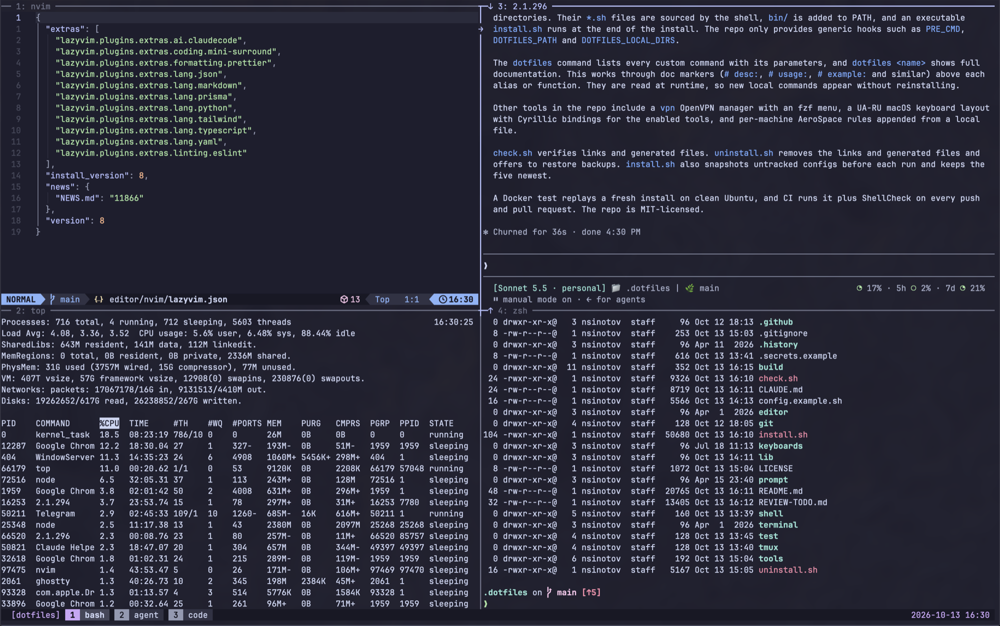
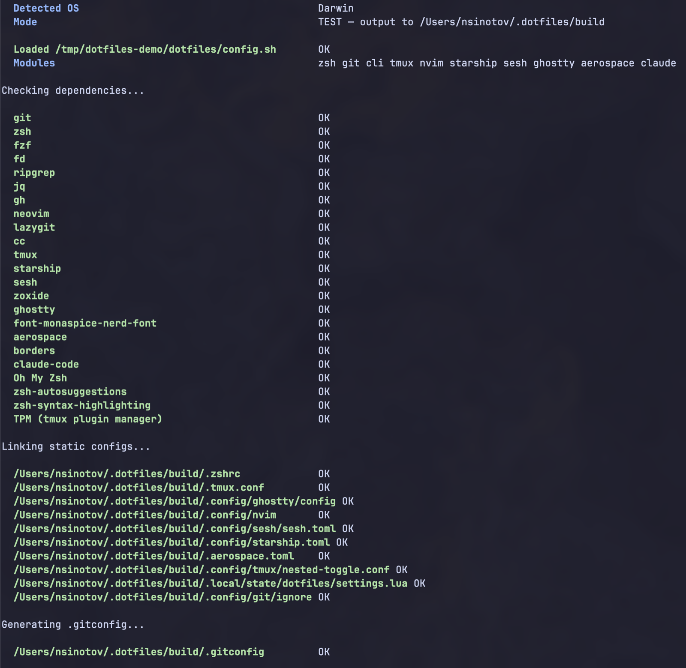
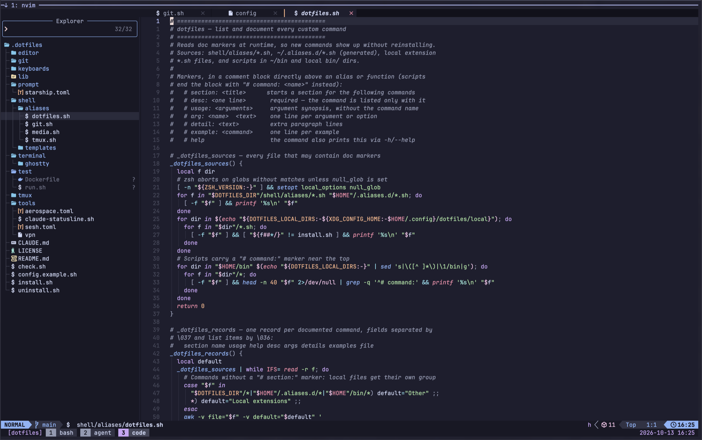
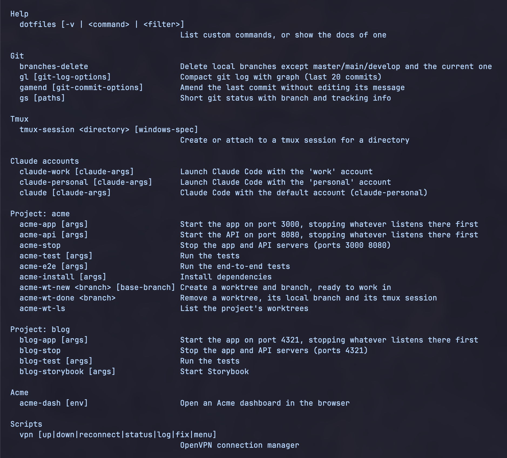

# dotfiles

[](https://github.com/nsinotov/dotfiles/actions/workflows/ci.yml)
[](LICENSE)

A modular macOS (and Linux) developer setup: zsh, tmux, Neovim, Ghostty and
AeroSpace in one Catppuccin theme. Pick the modules you want, and a single
installer sets them up with their packages.



- **Opt-in modules.** Nothing is installed unless you list it. Each module brings its own packages and bindings.
- **Nothing personal in the repo.** Identity, projects and tokens live in untracked `config.sh` and `.secrets`. Machine- or company-specific code goes in local extension dirs.
- **Project commands.** Each project gets generated commands: start servers (freeing the port first), run tests, and create or remove git worktrees with ready tmux sessions.
- **Several Claude Code accounts.** Isolated accounts with per-account env, secrets read at launch, and a status line.
- **Self-documenting.** `dotfiles` lists every command with its parameters; `dotfiles <command>` shows full docs and examples.
- **Tested.** CI replays a fresh install on Ubuntu, dry-runs every module on macOS with the stock bash 3.2, and lints all scripts.

## Contents

[Quick Start](#quick-start) ·
[Modules](#modules) ·
[Configuration](#configuration) ·
[Keybindings](#keybindings) ·
[Commands](#commands) ·
[Projects](#projects) ·
[Local Extensions](#local-extensions) ·
[Claude Code](#claude-code) ·
[Updating](#updating) ·
[Fork and Customize](#fork-and-customize) ·
[Troubleshooting](#troubleshooting) ·
[Uninstall](#uninstall) ·
[Repository Layout](#repository-layout)

## Quick Start

```bash
# 1. Clone anywhere; the scripts find their own location
git clone https://github.com/nsinotov/dotfiles.git ~/.dotfiles
cd ~/.dotfiles

# 2. The first run creates ~/.config/dotfiles/config.sh and .secrets, then stops
./install.sh

# 3. Edit config.sh: GIT_USER_NAME, GIT_USER_EMAIL and DOTFILES_MODULES
$EDITOR ~/.config/dotfiles/config.sh

# 4. Install. It offers to install Homebrew, each module's packages, Oh My Zsh and TPM.
#    --yes accepts every prompt; --dry-run writes everything to build/ instead of $HOME.
./install.sh

# 5. Verify, then open a new shell
./check.sh
exec zsh
```



Files that `install.sh` replaces are backed up next to the original as `<file>.bak.<timestamp>`. Move personal git settings from the old `~/.gitconfig` into `~/.gitconfig.local`; it is included last, so it wins.

**Requirements:** macOS with Xcode Command Line Tools and Homebrew (`install.sh` offers both), or Linux with apt. git is the only prerequisite. Tools without an apt package (starship, sesh, lazygit, Ghostty, Claude Code) are listed by `install.sh` for manual installation.

## Modules

`DOTFILES_MODULES` in `config.sh` lists what `install.sh` sets up. Removing a module and re-running `install.sh` removes its links.

| Module | Sets up | Packages |
| --- | --- | --- |
| `zsh` | `.zshrc`, Oh My Zsh + plugins, zsh as login shell; loads projects, Claude accounts and local extensions | zsh |
| `git` | Generated `~/.gitconfig` (identity, per-project emails), global ignore | — |
| `cli` | Everyday command-line tools | fzf, ripgrep, fd, jq, gh |
| `tmux` | `.tmux.conf`, TPM and plugins, F12 nested-session toggle | tmux |
| `nvim` | Neovim (LazyVim) config | neovim, ripgrep, fd, lazygit, C compiler |
| `starship` | Starship prompt | starship |
| `sesh` | Session picker (`prefix t` in tmux) | sesh, zoxide, fzf |
| `ghostty` | Ghostty config | Ghostty, Monaspice Nerd Font (casks) |
| `aerospace` | AeroSpace tiling window manager (macOS) | AeroSpace (cask), JankyBorders |
| `vpn` | `vpn` OpenVPN manager in `~/bin` | openvpn, fzf |
| `media` | `compress-pdf`, `compress-mov`, `compress-mp4` | ghostscript, ffmpeg |
| `claude` | Claude Code account functions and status line | Claude Code (cask), jq |
| `keyboard-ua-ru` | UA-RU layout (macOS), plus Cyrillic bindings for the enabled tmux, Ghostty and nvim modules | macism (macOS) |

Some modules and features depend on others: `claude`, projects and local `*.sh` extensions need `zsh`; `sesh` and `PROJECT_<N>_TMUX_WINDOWS` need `tmux`; `PROJECT_<N>_GIT_EMAIL` needs `git`. `install.sh` warns about each and asks whether to set it up for that run, and `check.sh` reports them.

## Configuration

All settings live in `~/.config/dotfiles/` (untracked):

| File | Holds |
| --- | --- |
| `config.sh` | Identity, modules, projects, Claude accounts, tool options. No secrets; safe to keep in a private repo. Template: [`config.example.sh`](config.example.sh) |
| `.secrets` | Tokens only (`chmod 600`), referenced by name from `config.sh`. Template: [`.secrets.example`](.secrets.example) |
| `starship.local.toml`, `aerospace.local.toml` | Per-machine additions appended to the tracked Starship and AeroSpace configs (extra `[tables]` only) |
| `local/` | Local extensions (see [below](#local-extensions)) |

`.zshrc` loads `config.sh` and `.secrets` as shell variables without exporting them; list names that child processes need in `DOTFILES_EXPORT`.

| Option | Effect |
| --- | --- |
| `DOTFILES_PATH` | Extra PATH entries, first wins |
| `DOTFILES_LOCAL_DIRS` | More local extension dirs, e.g. a private repo checkout |
| `DOTFILES_EXPORT` | Variables to export to child processes |
| `NVIM_EXTRAS` | Extra LazyVim extras, e.g. `"ai.claudecode lang.prisma"` |
| `NVIM_PLUGINS` | Extra Neovim plugins as `owner/repo`, e.g. `"ThePrimeagen/vim-be-good"` |
| `TMUX_NESTED_TOGGLE=false` | Drop the F12 nested-session toggle (set it on servers) |
| `CLAUDE_STATUSLINE=false` | Don't add the status line to Claude accounts |
| `EDITOR`, `TMUX_SESSION_WINDOWS` | Override the defaults |

## Keybindings

**tmux** — prefix `Ctrl-s`

| Keys | Action |
| --- | --- |
| `prefix \|` / `prefix -` | Split side by side / stacked, in the current directory |
| `Ctrl-h/j/k/l` | Move between panes and Neovim splits (no prefix) |
| `prefix H/J/K/L` | Resize the pane (repeatable) |
| `prefix c` / `prefix Tab` | New window / next pane |
| `prefix t` | Fuzzy session and directory picker (sesh) |
| `prefix s` / `prefix b` | Session tree / last session |
| `prefix S` / `prefix R` | Save / restore sessions (resurrect) |
| `prefix k` / `prefix r` | Clear pane and history / reload config |
| `prefix [`, then `v`, `y` | Copy mode: select, copy to the system clipboard |
| `F12` | Pass all keys to a nested (SSH) tmux; `F12` again to return |

**AeroSpace** — `alt` is Left Option

| Keys | Action |
| --- | --- |
| `alt-1` … `alt-0` | Switch workspace |
| `alt-shift-1` … `alt-shift-0` | Move window to workspace |
| `alt-ctrl-h/j/k/l` / `alt-shift-h/j/k/l` | Focus / move window |
| `alt-f` / `alt-shift-f` | Fullscreen / toggle floating |
| `alt-ctrl-/` / `alt-ctrl-,` | Tiles / accordion layout |
| `alt-tab` | Previous workspace |
| `alt-r`, then `h/j/k/l` | Resize mode (`esc` to leave) |

**Neovim** — LazyVim defaults, leader `Space`, plus

| Keys | Action |
| --- | --- |
| `Ctrl-h/j/k/l` | Move between splits and tmux panes |
| `<leader>sF` | Grep for a fixed string |
| `<leader>yp` / `<leader>yP` | Copy the file's relative / absolute path |



**Ghostty** — Left Option sends Alt (right Option still types special characters); `cmd-ctrl-f` toggles fullscreen.

## Commands

`dotfiles` lists every custom command with its parameters: repo aliases, generated project and Claude commands, scripts, and your local extensions.

```bash
dotfiles                  # all commands with their parameters
dotfiles acme-wt-new      # full docs: usage, arguments, details, examples
dotfiles wt               # only commands whose name or description contains "wt"
dotfiles -v               # everything, with examples
```



The docs come from marker comments above each alias or function, read at runtime, so a new local command appears without reinstalling:

| Marker | Meaning |
| --- | --- |
| `# section: <title>` | Group for the following commands |
| `# desc: <text>` | One-line description (required to be listed) |
| `# usage: <args>` | Argument synopsis, without the command name |
| `# arg: <name>  <text>` | One line per argument or option |
| `# detail: <text>` | Extra lines for the full docs |
| `# example: <command>` | One line per example |
| `# help` | The command also handles `-h`/`--help` |
| `# command: <name>` | Ends the block in a script (`~/bin`, local `bin/`) |
| `# module: <name>` | File-level: hide the commands unless the module is enabled |

## Projects

Each `PROJECT_<N>_*` block in `config.sh` generates commands prefixed with the project name:

```bash
PROJECT_1_NAME=acme
PROJECT_1_APP="yarn nx serve web"           # acme-app
PROJECT_1_APP_PORT=3000                     # acme-app frees the port first; acme-stop
PROJECT_1_API="yarn nx serve api"           # acme-api
PROJECT_1_API_PORT=8080
PROJECT_1_TEST="yarn nx affected -t test"   # acme-test (also _E2E, _STORYBOOK, _INSTALL, _REINSTALL)
PROJECT_1_WT_REPO="$HOME/projects/acme"     # acme-wt-new, acme-wt-done, acme-wt-ls
PROJECT_1_TMUX_WINDOWS="bash:4:tiled agent:1 code:1"
```

- **Servers with ports.** `acme-app` kills whatever listens on the port (with its parent processes) before starting, so another worktree's server is replaced. Ctrl-C stops the whole process tree.
- **Worktrees.** `acme-wt-new <branch> [base]` creates `acme-<branch>` next to the repo, copies `WT_ENV_FILES`, runs `WT_INSTALL`, and opens a tmux session laid out by `TMUX_WINDOWS`. `acme-wt-done <branch>` removes the worktree, its branch and its session.
- **Modifiers.**
  - `PRETEST` runs before servers, tests and installs, and a failure aborts them (e.g. a malware scan).
  - `ENV` passes project-only variables.
  - `DIR` + `GIT_EMAIL` sets the git email for every repo under a directory.

[`config.example.sh`](config.example.sh) lists every variable, and [`shell/templates/project.sh.tpl`](shell/templates/project.sh.tpl) shows the generated code. `tmux-session <dir> [windows-spec]` gives the same tmux layout for any directory.

## Local Extensions

Anything machine-, company- or project-specific belongs in a local extension dir, not in the repo. The default is `~/.config/dotfiles/local/`; `DOTFILES_LOCAL_DIRS` adds more.

| In each dir | Effect |
| --- | --- |
| `*.sh` | Sourced by `.zshrc`: aliases, functions, tool inits (nvm, conda) |
| `bin/` | Added to PATH |
| `nvim/init.lua`, `nvim/plugins/*.lua` | Extra Neovim code and plugin specs |
| `install.sh` (executable) | Run at the end of `install.sh`, e.g. to link `CLAUDE.local.md` files from a private repo |

Settings can call local code. For example, `CLAUDE_ACCOUNT_<N>_PRE_CMD="proxy_start"` runs a local function before that Claude account starts. [`shell/templates/local.sh.tpl`](shell/templates/local.sh.tpl) has annotated examples.

### Private companion repo (optional)

To rebuild a whole laptop, keep your personal layer in a separate private repo that builds on this one. This repo never depends on it, and works the same without it.

```
dotfiles-private/              (your private repo)
  config.sh                    settings, symlinked to ~/.config/dotfiles/config.sh
  starship.local.toml          per-machine additions, symlinked into ~/.config/dotfiles/
  local/                       a local extensions dir: *.sh, bin/, nvim/
  setup.sh                     one-time laptop setup: apps, macOS defaults, links above
  README.md                    the restore steps below, for your own machine
```

1. Clone both repos.
2. Run the private `setup.sh`: it links `config.sh` and the `*.local.toml` files, and installs your apps.
3. Add your tokens to `~/.config/dotfiles/.secrets` by hand, or have `setup.sh` fetch them from a password manager. Never commit them.
4. Run `./install.sh` here. `config.sh` sets `DOTFILES_LOCAL_DIRS` to the private `local/` dir.

Name the private script `setup.sh` rather than `install.sh`: an executable `install.sh` in a local extensions dir runs on every `install.sh` run here, which suits re-linking but not a one-time setup.

## Claude Code

The `claude` module generates one isolated `claude-<name>` command per account, and plain `claude` runs `CLAUDE_DEFAULT_ACCOUNT`:

```bash
# config.sh — a company proxy, a company login and a personal login
CLAUDE_ACCOUNT_1_NAME=proxy
CLAUDE_ACCOUNT_1_ENV="ANTHROPIC_BASE_URL=http://localhost:8080"
CLAUDE_ACCOUNT_1_SECRET_ENV="ANTHROPIC_AUTH_TOKEN=CLAUDE_PROXY_TOKEN"   # value from .secrets, read at launch
CLAUDE_ACCOUNT_1_PRE_CMD="proxy_start"                                 # local function, runs first
CLAUDE_ACCOUNT_1_LINK_HOME=true                                        # CONFIG_DIR → ~/.claude
CLAUDE_ACCOUNT_2_NAME=work
CLAUDE_ACCOUNT_3_NAME=personal
CLAUDE_DEFAULT_ACCOUNT=personal
```

Each account uses `~/.claude-<name>` unless `CONFIG_DIR` says otherwise; an account with only a `NAME` is a plain login (`/login` on first start). [`shell/templates/claude-account.sh.tpl`](shell/templates/claude-account.sh.tpl) shows the generated code.

`install.sh` also adds [`tools/claude-statusline.sh`](tools/claude-statusline.sh) to each account's `settings.json` (it never replaces a different status line):

```
[Sonnet 5.5 · personal] 📁 myapp | 🌿 feature/auth                ◑ 42% · 5h ○ 12% · 7d ◕ 78%
```

The status line shows the model, account and branch on the left. On the right, pie glyphs show context-window usage and the 5-hour and weekly subscription limits; they turn yellow at 70% and red at 90%. The limits appear only for claude.ai Pro/Max logins.

## Updating

```bash
cd ~/.dotfiles && git pull && ./install.sh && exec zsh
```

Configs are symlinked, so pulled changes apply at once. Re-running `install.sh` installs the packages of new modules and regenerates project and Claude commands. In Neovim, `:Lazy restore` syncs plugins to the committed `lazy-lock.json`; in tmux, `prefix U` updates plugins.

## Fork and Customize

1. Fork the repo and clone your fork; change the clone URL and badges in this README.
2. Edit the tracked configs directly. They are symlinked, so changes are live and show up in `git diff`.
3. Keep anything personal out of the repo: settings in `config.sh`, tokens in `.secrets`, code in a local extension dir.
4. Add a tool as a module: link it with `link_if` in `lib/install/links.sh`, add its packages to `DEPS` in `lib/install/deps.sh`, check it in `check.sh`, and document it in `config.example.sh` and this README.
5. Before pushing, run the tests: `docker build -f test/Dockerfile -t dotfiles-test . && docker run --rm dotfiles-test` (Linux fresh install) and `test/macos-dry-run.sh` (macOS).

## Troubleshooting

| Problem | Fix |
| --- | --- |
| Custom commands are missing | Check that `zsh` is in `DOTFILES_MODULES`, run `./check.sh`, then `exec zsh` |
| Icons show as boxes | Use a Nerd Font in your terminal (the `ghostty` module installs Monaspice) |
| tmux plugins or theme missing | Press `prefix I` to install them |
| Neovim errors on Linux | LazyVim needs Neovim 0.11+; Ubuntu's apt package is older. Install Neovim from its releases or Homebrew |
| A `*.local.toml` change has no effect | Re-run `install.sh`; those configs are generated, not linked |
| UA-RU layout missing from Input Sources | Log out and in, then add it under System Settings → Keyboard → Input Sources |
| Claude status line not shown | Install `jq`, re-run `install.sh`, and restart Claude Code |
| A package is "not in apt" | Install it manually; `install.sh` names each one |

## Uninstall

```bash
./uninstall.sh --dry-run   # show what would be removed
./uninstall.sh             # remove after one confirmation (--yes: no prompts)
```

This removes every symlink into the repo, every generated file, and the Claude status line entries it added. It offers to restore the `.bak` backups `install.sh` made. Installed packages, Oh My Zsh, TPM, Claude account dirs and `~/.config/dotfiles` are kept.

## Backups

Before changing anything, `install.sh` snapshots the untracked files into `~/.config/dotfiles/backups/<timestamp>/` (owner-only, newest 5 kept):

- `config.sh`, `.secrets`, `local/`, and the `*.local.toml` files.
- With the `claude` module: each account's `settings.json`, plus the Claude Desktop configs on macOS.

To restore, copy the files back and re-run `install.sh`.

## Repository Layout

```
install.sh, check.sh, uninstall.sh   install, verify, remove
lib/dotfiles.sh                      config loading and module helpers (shared)
lib/install/*.sh                     install phases: config, backup, deps, links, gitconfig,
                                     projects, claude, keyboard, hooks
shell/                               .zshrc, aliases/ (incl. dotfiles command), templates/
editor/nvim/                         Neovim (LazyVim) config
tmux/                                .tmux.conf + optional includes (Cyrillic, F12 toggle)
terminal/ghostty/                    Ghostty config + optional Cyrillic include
prompt/                              Starship config
git/                                 gitconfig template, global ignore
tools/                               AeroSpace, sesh, vpn, Claude status line
keyboards/                           UA-RU macOS keyboard layout
test/                                Docker fresh-install test, macOS dry run
```

Design decisions: static configs are symlinked so edits are live; anything personal is generated from untracked settings and references secrets by name; every tool is an opt-in module; one Catppuccin Mocha theme across Ghostty, Neovim and tmux.

## License

[MIT](LICENSE)
